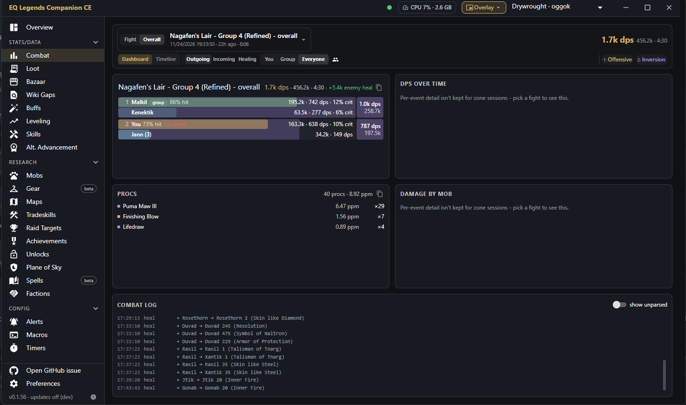
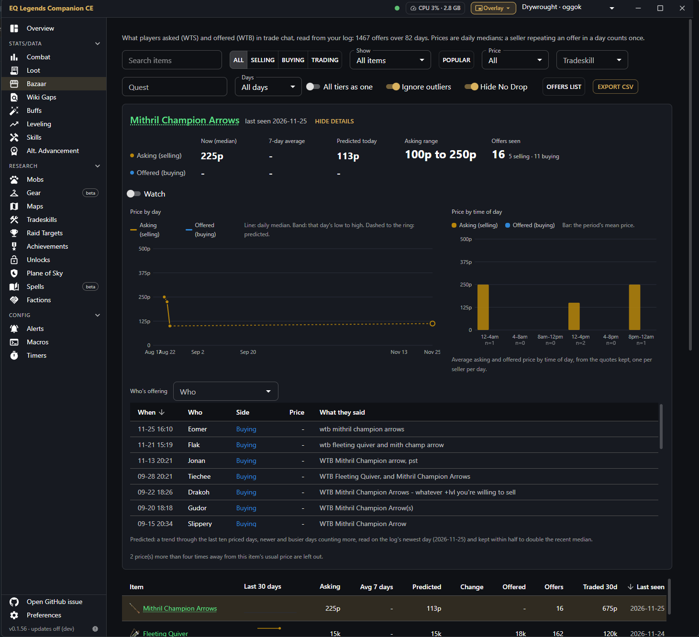
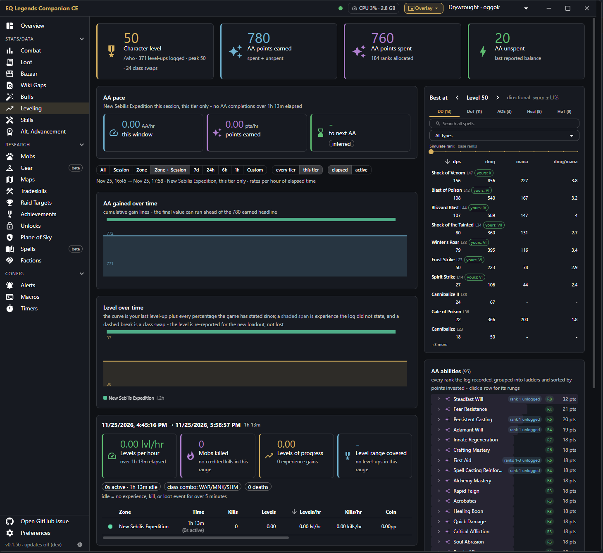
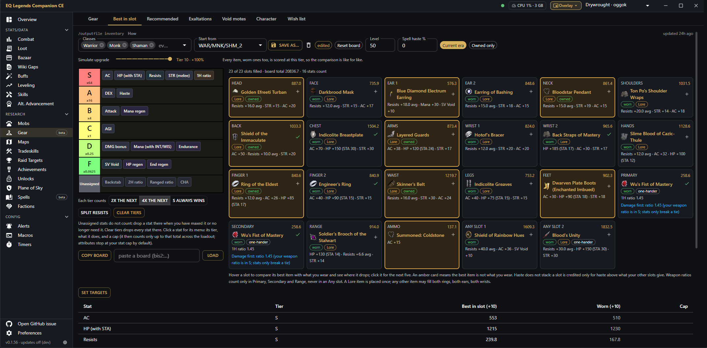
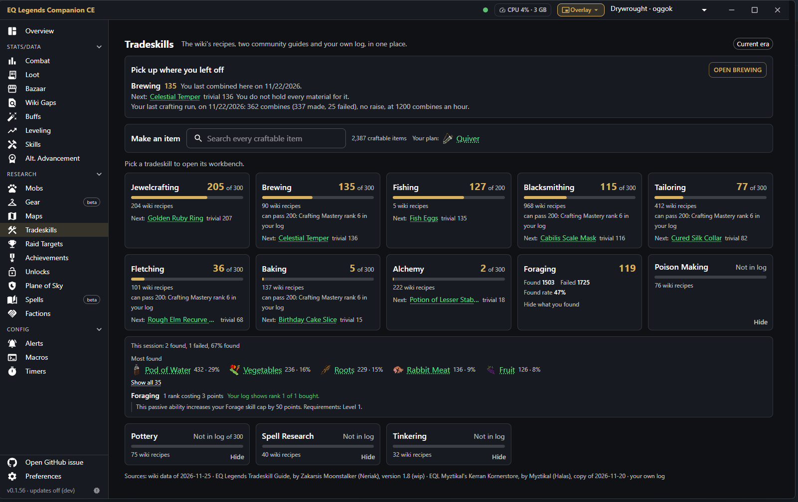

# EQ Legends Companion: Community Edition

A Windows desktop companion for **EverQuest Legends**. It reads the log file the game already
writes and turns it into live, useful views: a DPS meter, floating overlays, quest, loot and gear
tracking, trade-chat prices, tradeskills, maps and alerts.

**[Download the latest release](https://github.com/kaltinril/everquest-companion/releases/latest)** ·
[What it does](#what-it-does) · [A look around](#a-look-around) ·
[First run](#download-and-first-run) ·
[Report a problem](https://github.com/kaltinril/everquest-companion/issues)

**It only reads files the game writes.** Your log, and a few files in your EverQuest folder, such
as the `/outputfile` lists, your UI settings, your macros and the spell data. Nothing is injected
into EverQuest, no memory is read, and nothing is automated or played for you. It changes no game
file unless you ask it to, in one of two ways:

- **Summarize and archive log** (off until you turn it on) moves a full log file into a
  `companion-archive` folder inside the game's Logs folder, so a fresh one starts.
- **Macros:** when you send a macro set to a character, the app writes it into that character's
  game file. It makes a copy of the file first, and refuses while EverQuest is running.

If you turned off logging, the app simply has nothing to show.

This project began as a fork of [**EQ Legends Companion**](https://github.com/jmoyers/everquest-companion)
by **Josh Moyers**. He built the app and its engine, and the credit for that is his. He is no
longer active on it, so this repo runs the app as its own project, with its own releases, its own
issue tracker and its own direction.

## What it does

Everything is per-character: switch characters and the app re-reads that log.

**What your log says**

- **Overview:** the at-a-glance page the app opens on. **Customize** picks its cards (damage,
  leveling, target, DPS over time, recent drops and kills, buffs running out, respawns here, motes
  and coin), and **Edit layout** lets you drag them into place and set each card from one to four
  columns wide.
- **Combat:** a live DPS meter with per-fight and per-zone numbers, fight history, a drill-down
  into each attack and spell, procs per minute, a timeline of the pull, and a death recap when
  you die. Healing has its own meters.
- **Loot:** a running history of what you looted, and what each item is for: which quests use
  it, what it turns in for, which recipes consume it.
- **Bazaar:** what trade chat asks and offers, per item: price by day and by time of day, a
  predicted price, who is buying or selling, and a watchlist that alerts.
- **Wiki Gaps:** the names your log mentions that the wiki data has no record of, with a Copy
  button that drafts the wiki page.
- **Buffs:** remaining time on your buffs and debuffs, learned from the log, and which of your
  spells did not take hold and what blocked them.
- **Leveling:** XP and AA progress per character, with history, and the best spells of each type
  at your level.
- **Skills:** every skill your log has seen go up, at its newest level.
- **Alt. Advancement:** what your AAs give you, what is left to buy and what it costs, for your classes or any combination; your stat cap and reincarnation lines; a warning before the 50-point cap.

**Looking things up**

- **Mobs:** look up a mob and what it drops.
- **Gear** (beta): drop sources, worth scores and the +0 to +10 upgrade slider. Its other tabs:
  **Best in slot** (rank the stats you care about from S to F and it fills every slot with the
  best item, from what you own or from the whole game), **Recommended** (a level route with the
  gear to aim for), **Exaltations** (the socket board optimizer), **Void motes** (where the week's
  three are best spent), **Character** and **Wish list**.
- **Maps:** clickable zone links, mob pins, travel routes, ports, and where to level.
- **Tradeskills:** one card per tradeskill with your level from the log and the next recipe to
  raise it, a workbench with the wiki's recipe book, what foraging has found, and a search over
  every craftable item. It builds on the wiki's recipes and two guides written by players (see
  [Thanks](#thanks)).
- **Raid Targets:** which named and raid mobs you have killed and when.
- **Achievements:** your open achievements, with a Slayer planner that ranks the zones to work in.
- **Unlocks:** the races, classes and deities you have not unlocked yet, and what each still needs.
- **Plane of Sky:** every class's Test quests with "have / need" chips per item, item stats on
  hover, and sorting by closest-to-done.
- **Spells** (beta): a spellbook, the upgrades each spell line has, and loadouts with buff
  stacking.
- **Factions:** your standings, read from the game's `/outputfile faction`.

**Alerts, macros and timers**

- **Alerts:** play a sound, speak a line or show a banner when something happens: a charm break,
  a buff fading, a raid target dying, or any log line you write a rule for.
- **Macros:** your own macro library, kept in sets, beside what each character's game file holds.
  Send a set to a character when you are ready (see above).
- **Timers:** respawn clocks started by your own kills.

**Overlays**

Small always-on-top windows you can leave over the game, turned on from the **Overlay** menu in
the title bar: damage and healing meters (the current fight or the whole zone), buff and debuff
timers, XP per hour, respawn countdowns, your next weapon swing, a mob card when you `/con`, the
Plane of Sky quests you starred, map pins over the game's map, and the top of the Wiki Gaps list.
Lock one and it becomes click-through. The same menu resets every overlay's position.

A **cursor overlay** (in **Preferences**) marks your mouse pointer over the game with a shape,
your own icon or drawing, crosshair lines or a trail. **Hotkeys** (in **Preferences**, off until
you set them) bring every overlay back to the front, or turn the cursor overlay on and off while
you play.

**Your log file**

- **Summarize and archive log** (in **Preferences**, off until you turn it on): once your log
  passes 100 MB the app moves it into a `companion-archive` folder inside the game's Logs folder
  and keeps your history showing, and the game carries on in a fresh, small log file.

## A look around

<table>
  <tr>
    <td width="50%" valign="top"> <b>Bazaar.</b> Trade-chat prices per item, by day and by time of day, a predicted price, and who is buying or selling.</td>
    <td width="50%" valign="top"> <b>Leveling.</b> Level and AA pace, the AA ranks you hold, and your best spells at your level.</td>
  </tr>
  <tr>
    <td colspan="2"> <b>Gear, Best in slot.</b> Rank the stats you care about from S to F; it picks the best item for every slot and marks what you already wear or own.</td>
  </tr>
  <tr>
    <td colspan="2"> <b>Tradeskills.</b> Pick up where you left off: your level in each tradeskill, the next recipe to raise it, and what foraging has found.</td>
  </tr>
</table>

## Download and first run

**Requires 64-bit Windows 10 or 11.** Windows 8.1 and older cannot run it: the installer checks
and stops with a message.

1. Download the newest `everquest-companion-ce-Setup-<version>.exe` from this repo's
   [**Releases**](https://github.com/kaltinril/everquest-companion/releases/latest) page.
2. Run it. Windows SmartScreen will say "Windows protected your PC", because the installer is not
   code-signed: click **More info**, then **Run anyway**. It is a one-click, per-user install with
   no admin prompt. It adds a Start-menu and a desktop shortcut named **EQ Legends Companion CE**.
3. In EverQuest, type `/log on`.

The app finds your log by itself, usually in
`C:\Users\Public\Daybreak Game Company\Installed Games\EverQuest Legends\Logs\`. If your install
lives somewhere else, set the **EverQuest install folder** in **Preferences**.

Overlays sit on top of the game in **windowed** or **borderless** mode. Exclusive fullscreen
cannot be overlaid by anything, so use borderless if you want them.

## If you have the original app installed

The app installs **beside** the original app, never over it. It has its own name, its own install
folder and its own settings folder (`%AppData%\everquest-companion-test\`), so the two never
overwrite each other and can run at the same time.

On its first launch, if the original app's settings folder is there, the app copies these from it
once: your settings, the learned spell messages, the item cache, the sound-pack list and your
installed sound packs, the learned resists, and the choices you made in each view. It is a copy:
the original app and its folder are never changed.

## Updates

The app updates itself in the background from this repo's Releases page, and from nowhere else.
When a new version has downloaded, a **Restart to update** button appears at the bottom of the left
menu. Click it to update now, or the update installs the next time you quit the app (if the app
closes to the tray, use **Quit** on the tray icon). To stay on the version you have, turn off
**Update automatically** in **Preferences**.

Updates are not code-signed either. They rest on this repo's GitHub account and the HTTPS download,
the same as a download by hand.

## Make it yours

- **Sound and voice packs.** Alert sounds come from packs. One voice pack installs itself on first
  launch, and you can browse and install more from inside the app (**Alerts**, then
  **Sound packs…**). To add your own: drop a folder into
  `%AppData%\everquest-companion-test\soundpacks\<your-pack>\` containing your `.wav`, `.mp3` or
  `.ogg` files and a small `manifest.json` naming them. It then shows up in every sound picker.
- **Share alerts.** An alert, or all of them at once, copies to a short paste-safe string. Whoever
  pastes it back in gets a preview before anything is added. Imports only add: they never
  overwrite your alerts.
- **Share your setup.** Export your settings as one string or a file (**Preferences**, under
  **Profiles**). It carries no file paths, no window positions and no character progress.

## Privacy

The app sends no usage counts and no feedback reports: the code that did is removed from this
project. What it does ask the network for:

- **Updates:** a check against this repo's Releases page, and the installer when there is a newer
  one.
- **The EverQuest Legends wiki:** only when you click **Copy** on a row of the Wiki Gaps tab, to
  read the page that row is about. Everything else the app shows comes from data and pictures
  shipped inside it.
- **Your loot, sent to the wiki's drop database:** only if you turn on **Send my loot to the
  wiki** (**Preferences**, under **Game**; off until you do). It sends the loot your log records,
  so the wiki can work out drop rates, and signs in with a wiki bot password you make for it,
  never your main password. Your character's name is not sent.
- **Sound and voice files:** the first voice pack on first launch; the list of packs, and any
  sound you preview, when you open **Sound packs…**; and any sound pack or spoken-alert voice you
  choose to install. These come from GitHub (and, for the spoken-alert voice, a Microsoft runtime
  download when your PC does not already have it).

`SECURITY.md` in this repo was written for the original app. It does not describe this build.

## Reporting a problem

Open an issue on [**this repo's Issues page**](https://github.com/kaltinril/everquest-companion/issues).
The **Open GitHub issue** row in the app's menu opens the page for a new one.

## Development

Contributions are welcome as pull requests to this repo. Each one is read in full before it is
taken in. Read these in order:

1. [docs/community/README.md](docs/community/README.md): how the project is run (branches, the
   checks every change must pass).
2. [docs/community/RULES.md](docs/community/RULES.md): the rules that bind every change.
3. [`AGENTS.md`](AGENTS.md): the code manual, written by the original author. Where it and the
   rules disagree, the rules win.

## License

The fork's own work is MIT: see [`LICENSE-MIT`](LICENSE-MIT). The original code by Josh Moyers
stays under his FSL-1.1-MIT (Functional Source License, converting to MIT two years after each
version, about August-September 2028): see [`LICENSE`](LICENSE), Copyright (c) 2026 Josh Moyers.
[`LICENSING.md`](LICENSING.md) explains which code is under which, and how to tell.

## Thanks

**Josh Moyers** wrote the original app, EQ Legends Companion, and its engine:
[jmoyers/everquest-companion](https://github.com/jmoyers/everquest-companion). That repo is no
longer updated (its last release is v1.16.0).

The item icons and raid-boss portraits this app draws come from two volunteer-run EverQuest wikis:
[**wiki.project1999.com**](https://wiki.project1999.com/) (boss portraits) and
[**eqlwiki.com**](https://eqlwiki.com/) (item icons, and the item, spell and quest knowledge behind
them). Those images are **copied into the app at build time** (`resources/wiki-images/`,
regenerated with `npm run fetch:images`), so the running app never asks either site for a picture,
and [`resources/wiki-images/manifest.json`](resources/wiki-images/manifest.json) records the exact
source URL, byte length and SHA-256 of every file it ships. Neither wiki is affiliated with this
app. The same credit is in the app itself, under **Preferences**, then **Thanks**.

The text of the **EverQuest Legends Wiki** (eqlwiki.com) is licensed
[CC BY-SA 4.0](https://creativecommons.org/licenses/by-sa/4.0/), as its
[About page](https://eqlwiki.com/index.php?title=Project:About) states; the item, mob, spell
and quest data this app builds from it is credited to that wiki.

The **Tradeskills** section builds on two guides written by players, copied into the app at
build time and checked again at every release (`scripts/community/guides-pull.mts`):
the [**EQ Legends Tradeskill Guide**](https://docs.google.com/spreadsheets/d/e/2PACX-1vTNj3GiLZ4nXBfLkGEB2iGkJy_WV4Mfkth5nwyg3pSfjJEiEreIsspJhIcSZAIS5hbSDwZbawzk4jEz/pubhtml)
by **Zakarsis Moonstalker** (Neriak), for its leveling routes, and
[**EQL Myztikal's Kerran Kornerstore**](https://drive.google.com/file/d/1VcUmqXTclXafiMxQvCr2G5HvtgRc7ew5/view)
by **Myztikal** (Halas), for its recipes with the merchant and location of each material. The
work of finding those out is theirs. Neither author is affiliated with this app. The same credit
is in the app under **Preferences**, then **Thanks**.

The default **Alan Rickman** voice pack, which the app downloads on first launch, comes from
[utensils/openpeon-alan-rickman-soundpack](https://github.com/utensils/openpeon-alan-rickman-soundpack)
and is licensed CC-BY-4.0. Packs you install from the in-app browser carry their own
licenses and attribution (see each pack's manifest); none of them are part of this
repository.
