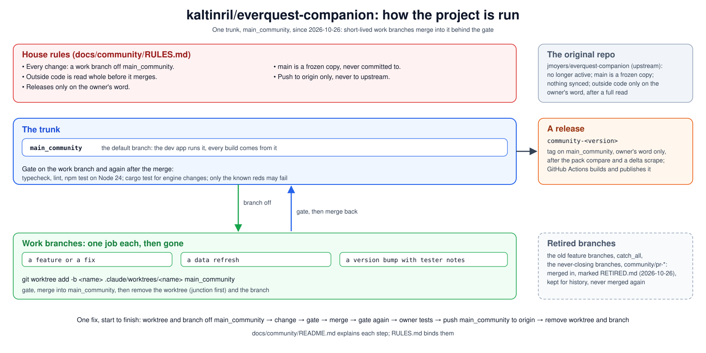

# How the fork is run

This repo (`kaltinril/everquest-companion`, git remote `origin`) runs EQ Legends Companion as its
own project on one trunk, `main_community`, to move fast and change course easily (since
2026-10-26). It began as a fork of `jmoyers/everquest-companion`; the creator is no longer active
on the project and other tools now compete for the same players, so nothing here tracks the
original repo or waits on it ([The original repo](#the-original-repo), last section). This
directory holds the rules and records that make that safe.

Read [RULES.md](RULES.md) before touching any branch. [ADOPTIONS.md](ADOPTIONS.md) records every
outside pull request that was vetted, adopted or deferred. [ISSUES.md](ISSUES.md) records every
issue that was looked at, on this repo and on the original one, and what became of it.
[requirements/](requirements/) holds each feature area's list of what was asked for (rule 19).
[RELEASING.md](RELEASING.md) is how a build reaches the fork's Releases page.
[BRANCHES.md](BRANCHES.md) is the record of the retired branches and the list of known test reds.
[agent/](agent/INDEX.md) is the working manual for AI agents.

## How to work in this fork

The same steps for people and agents:

1. **Set up:** Node 24 (Node 22 gives hundreds of false test failures), Rust via rustup, then
   `npm ci`.
2. **Make a work branch and worktree off `main_community`:**
   `git worktree add -b <name> .claude/worktrees/<name> main_community`. Never commit to `main`,
   and never work in the main clone, where the dev app rebuilds on every file that changes.
   Nothing is created beside the repo folder.
3. **Write down the ask first.** A feature's requests go in `requirements/<feature-area>.md`
   before any code. Check every row before changing a feature.
4. **Keep it small.** Change only what the feature needs and match the code around it.
5. **Gate it, scoped to the change** (RULES.md rule 11): `npm run typecheck`, `npm run lint`, and
   on Node 24 only the unit test files that touch what changed. Cargo tests only when
   `bash scripts/community/engine-changed.sh` prints yes, and then only for the crates touched.
   The full suite (`known-reds.sh`, `cargo test --workspace`, the e2e suite) runs before a
   release. No unit or engine test is a known red since 2026-11-27, so any failure is a
   regression (BRANCHES.md).
6. **Merge it:** close the dev app and merge the work branch into `main_community` from the main
   folder. A merge whose tree equals the gated tree is not gated again; one that brought in other
   work is. Then remove the worktree and the work branch (rule 18).
7. **Push after testing:** once the owner has tried it in the app, push `main_community` to
   `origin`. Never to `upstream`.
8. **Record what you learned.** Rules, procedures and measured facts go in this directory, so
   anyone who clones the repo has them.

## At a glance

Every change of ours, and every vetted outside pull request, is a short-lived work branch off
`main_community` that merges back behind the gate and is then removed. A `community-<version>` tag
on `main_community` builds a release. The original repo is a frozen reference: nothing is synced
from it. The picture is [fork-workflow.svg](fork-workflow.svg), plain SVG, so a change to the
process is a change to that file in the same commit.

## Why

1. **One trunk is fast.** Until 2026-10-26 every change was its own branch off `main`, kept so it
   could go back to the creator as a pull request, and `main_community` was rebuilt from an
   ordered recipe of about seventy of them. That cost a branch, a recipe line and a merge per fix,
   and conflicts between branches that touched the same files. With the creator no longer active
   on the project and handing changes back no longer a goal, all of it is retired.
2. **The original is a frozen reference, not something to track.** Its `main` has not moved since
   2026-09-03 and the trunk is 4,685 commits past it (2026-11-28), so no sync is routine work.
   `main` and the
   `upstream` remote stay, untouched, so the original can still be read.
3. **Outside code stays untrusted.** Whatever comes from outside, a pull request on this repo or
   anything the owner asks for from the original, is read in full before it merges (RULES.md,
   rules 5 to 8).

## The branches

| Branch | Lifetime | Purpose |
|---|---|---|
| `main_community` | forever | The trunk. Every change lands here; the dev app runs it and every test build and release is cut from it. The fork's default branch on GitHub, so its root `README.md` is the front page. |
| `main` | forever | A frozen copy of the original repo's `main` (last commit 2026-09-03), kept as a reference. Never committed to, never synced as routine work (rule 2). Pushed to `origin` only, never to `upstream`. |
| work branches | one job | A short-lived branch off `main_community` in its own worktree; merged back, then deleted with its worktree. |
| retired branches | kept | Every other branch, retired on 2026-10-26 with a `RETIRED.md` note: the old feature branches, `catch_all`, `main_community_rules`, `local-data-refresh`, `community_release_rules`, `test-neutering`, the `community/pr-*` copies. Never deleted, never merged again (rule 9). Listed in BRANCHES.md. |

## Procedures

**Adopt a third-party PR.** A pull request opened on this repo: `gh pr list` lists them, and
`git fetch origin pull/<N>/head` puts its head at `FETCH_HEAD`, read-only. Vet it (RULES.md, rules
5 to 8). Make a work branch off `main_community` and merge or cherry-pick the PR's commits onto it,
never the contributor's ref straight into the trunk. Run the gate there. Add the ADOPTIONS.md row.
Merge into `main_community`, gate again, remove the work branch. A pull request opened on the
original repo is adopted the same way, from its `upstream/pr/N` ref, and only when the owner asks
(last section).

**Merge while the dev app is up.** `npm run dev` runs `electron-vite dev --watch` in this clone,
so every file a merge writes restarts Electron, and a merge burst relaunches the app on a
half-merged tree. Close the app before merging into `main_community`, and make sure the watcher
itself is gone: stopping the shell or task that started `npm run dev` can leave the
`node ... electron-vite.js dev --watch` process running, and it relaunches the app on its own
(2026-10-01). Find it with `Get-CimInstance Win32_Process -Filter "Name='node.exe'"` and a
CommandLine match on `electron-vite`, stop that one process, and its Electron exits with it.
Relaunch after the merges with `node_modules/.vite` cleared.

**Background work while the owner uses the app.** The app's engine must announce itself within
10 seconds of launch. Several parallel typecheck, test or cargo runs pinned the CPU at 100% and
the engine missed that deadline three times (2026-10-01, the "data engine started but never
answered" banner, nothing actually broken). While the owner has the app open, run build and test
work at a low priority, one job at a time. Since 2026-11-27 the e2e runner, `known-reds.sh`,
`npm test` and the engine builds the repo starts lower themselves to BelowNormal; a hand-run
cargo does not (agent/WORKFLOW.md, Agent tooling traps).

**Cut a test build.** Bump the version and write the tester notes as a commit on a work branch
off `main_community`, merge it, then `npm run dist`. Read the previous build's notes first; they
list what the testers caught. The installer is
`release/<version>/everquest-companion-ce-Setup-<version>.exe` in this clone, next to the
earlier builds (RULES.md, rule 17). `npm run dist` runs in this clone, never in a worktree (rule
16): a junctioned `node_modules` ships an asar missing dependencies. Before handing a build out,
`npx @electron/asar list release/<version>/win-unpacked/resources/app.asar` must list
`\node_modules\conf`; a build without it fails at launch. A GitHub release is RELEASING.md, on the
owner's word only (rule 10).

## The original repo

`jmoyers/everquest-companion` (git remote `upstream`) is a frozen reference, not something the
fork tracks. The creator is no longer active on it: its last release is v1.16.0 (2026-09-04), the
last commit on its `main` is 2026-09-03, and `main_community` is 4,685 commits past that and 0
behind (2026-11-28). Nothing is synced from it as routine work, nothing is offered to it, and nothing is ever
pushed to it (RULES.md, rules 2, 4 and 9). The pull requests and issues the fork opened there
earlier are left as they are.

**Look at it, when the owner asks.** `git fetch upstream` (read-only). It updates `upstream/main`
and, through the remote's second refspec `+refs/pull/*/head:refs/remotes/upstream/pr/*`, one
`upstream/pr/N` ref per pull request there. What the owner asks to take is read in full and
brought in on a work branch (rules 4 to 7), with its row in ADOPTIONS.md.

**`main` stays where it is.** It moves only if the owner asks for it to be brought up to the
original's, and then by fast-forward (`git fetch upstream main:main`), never by a commit;
`releaseNotes.ts` then follows rule 13. A push of `main` to `origin` starts `build.yml` (and
`infra.yml` or `pages.yml` when their paths changed): those workflows trigger on that branch.
